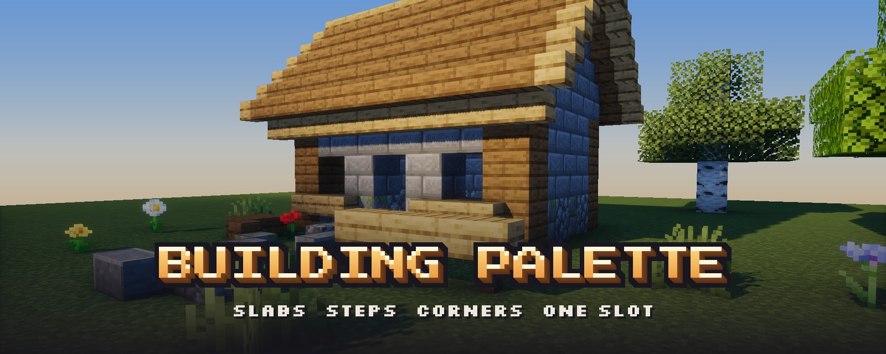
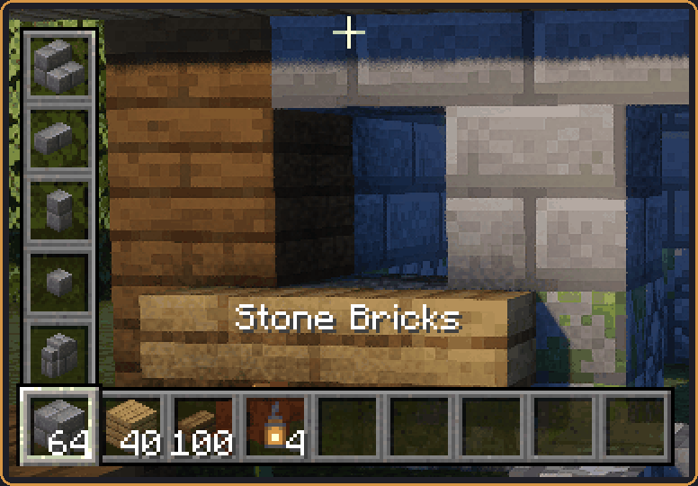
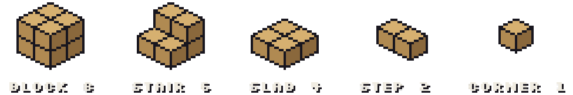
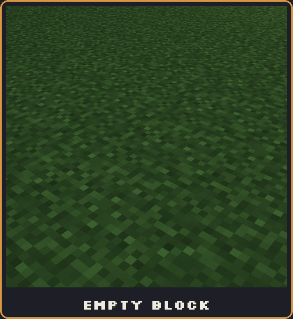
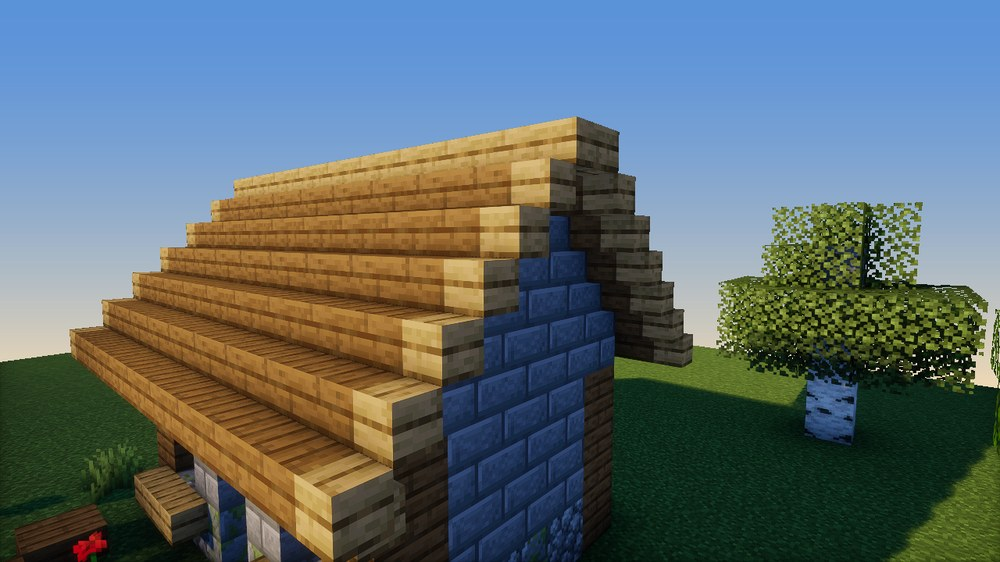
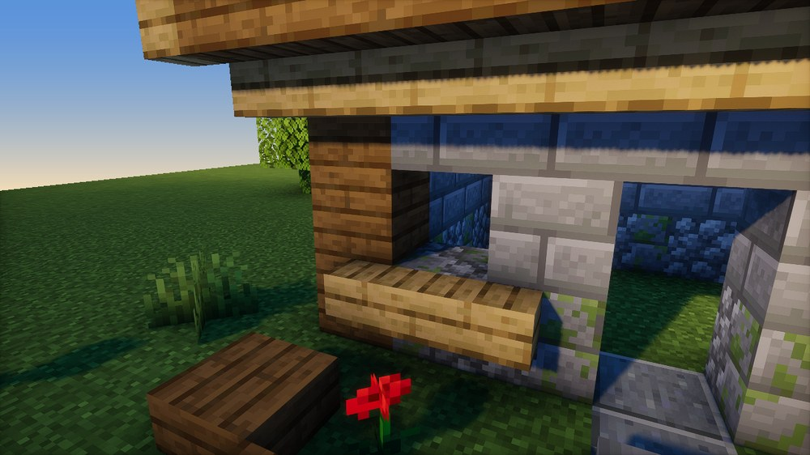
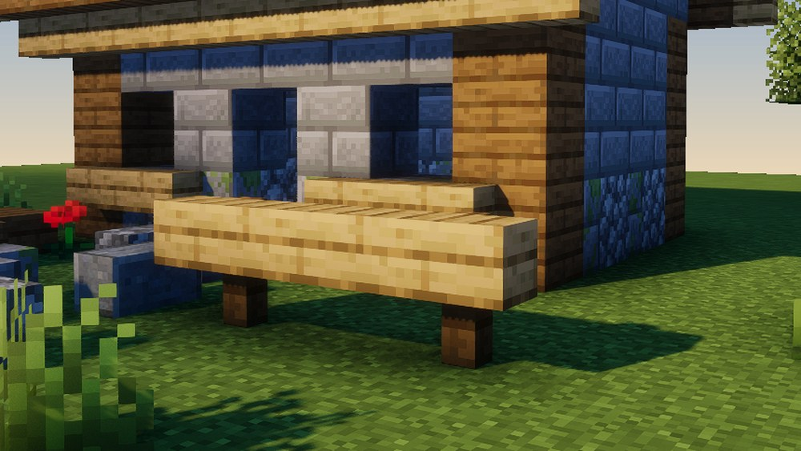

<b>Every shape of a block in one stack. Build on a half-block grid, mix materials inside a block, and pay only for what you place.</b>

Hold **Alt** and scroll to change a stack's shape, in your hand or in any inventory. A stack of 64 blocks is 128 slabs, 256 steps or 512 corners, all in the same slot.

 

Leftovers are kept: a **+** beside the count means material waiting for a smaller shape.

Pieces snap to a half-block grid and stack inside one block, in any mix of materials. Lay a step across another and they merge into an L, costing only the added corner. Mining takes the piece you aim at and returns exactly its material.

 

Fences, walls, panes, bars and chains pass through any piece, placed in either order.

| Input | Does |
|---|---|
| **Alt** + scroll | Change shape |
| Middle-click | Pick the pointed material; tops up from inventory or [Traveler's Backpack](https://modrinth.com/mod/travelersbackpack) |
| Drop onto a stack | Merge into that stack's shape |
| Shift-click | Fill partial stacks first |

Precise half-grid placement, placement preview and part highlighting are in **Mods → Building Palette → Configure** (Mod Menu on Fabric).

Install on **client and server**, Minecraft **26.3**, Java **25**.

| | Fabric | NeoForge |
|---|---|---|
| Loader | 0.19.5+ with [Fabric API](https://modrinth.com/mod/fabric-api) | 26.3.0.76+ |
| Required | [Clutter No More](https://modrinth.com/mod/clutternomore) 3.1.x, [Offgrid](https://modrinth.com/mod/offgrid) 1.0.x | same |

**Alpha:** back up your world first, and keep the mod installed while a world contains combined blocks. Combined blocks can't be pushed by pistons. Functional blocks are excluded; pack authors can adjust materials with the `building_palette:included` and `building_palette:excluded` item tags.
